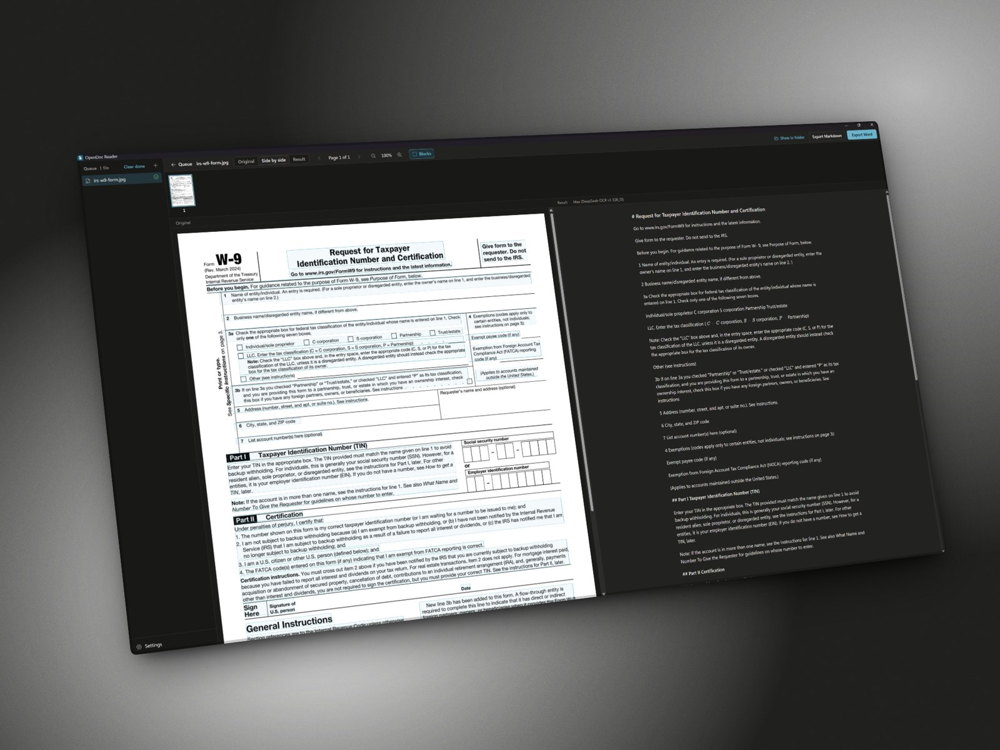

<h1 align="center">
  
  &nbsp;OpenDoc Reader
</h1>

<p align="center">
  Turn scanned documents and photos of pages into editable Word and Markdown files, using state-of-the-art OCR models that run entirely on your own computer.
</p>

<p align="center">
  <a href="https://github.com/ShabGaming/opendoc-reader/releases"></a>
  <a href="LICENSE"></a>
  <a href="#download"></a>
  <a href="https://tauri.app"></a>
  <a href="#models"></a>
  <a href="#privacy"></a>
</p>

<p align="center">
  <a href="https://github.com/ShabGaming/opendoc-reader/releases">Download</a> ·
  <a href="#features">Features</a> ·
  <a href="docs/user-guide.md">User guide</a> ·
  <a href="#build-from-source">Build from source</a> ·
  <a href="https://github.com/ShabGaming/opendoc-reader/issues">Report an issue</a>
</p>



> **Status: v0.1, first release.** Tested on Windows with an NVIDIA GPU and on CPU. macOS builds are new; please [report anything that breaks](https://github.com/ShabGaming/opendoc-reader/issues).

## Features

- **Everything stays on your computer.** No account, no cloud, no uploads. After the one-time model download the app works offline.
- **Picks the right model for your hardware.** Setup checks your graphics card, memory and disk, recommends a model, and downloads it with resume and checksum verification.
- **Keeps the structure, not just the text.** Headings, paragraphs, reading order, lists, tables with merged cells, formulas as real Word equations, figures and page breaks.
- **PDFs and images.** PDF, PNG, JPG, multi-page TIFF, BMP, WebP and HEIC. Pages are rotated upright and straightened automatically. PDFs that already contain text can use it directly, instantly.
- **Batch queue.** Drop many files or whole folders. Pause, cancel, and pick up where you left off after a restart.
- **Side-by-side review.** Check every page next to the original, with each detected block outlined and linked to its result.
- **Saved where you expect.** `invoice.pdf` becomes `invoice.docx` and `invoice.md` next to the original. Existing files are never overwritten.

## Models

The app shows three tiers. A details panel shows the underlying model and its license before you download it.

| Tier | Model | Best for | Speed on an RTX 4090 |
| --- | --- | --- | --- |
| **Fast** | PP-OCRv6 + PP-StructureV3 | Plain text and simple layouts, any CPU. Tables and formulas are kept as images. | 4 to 11 s per page (CPU) |
| **Accurate** | PaddleOCR-VL 1.6 (0.9B) | Tables, formulas and complex layouts. Needs about 2.3 GB of GPU memory, also runs on CPU. | 4 to 11 s per page |
| **Max** | DeepSeek-OCR (3B) | Difficult scans on a GPU with 8 GB or more, or an Apple Silicon Mac with 16 GB or more. | 2 to 4 s per page |

DeepSeek-OCR 2 is available as an experimental option for advanced users. Speeds come from the [model benchmark](docs/spike/2026-10-model-spike.md) on one desktop PC; laptops are slower, and Apple Silicon figures are estimates.

## Download

Get the latest installer from the [Releases page](https://github.com/ShabGaming/opendoc-reader/releases).

| Platform | File | Requirements |
| --- | --- | --- |
| Windows | `OpenDoc Reader_x.y.z_x64-setup.exe` (or `.msi`) | Windows 10 22H2 or later, 64-bit, 8 GB RAM |
| macOS | `OpenDoc Reader_x.y.z_aarch64.dmg` | macOS 13 or later on Apple Silicon (M1 or newer) |

The installer is about 20 MB. Setup then downloads the model you choose (0.2 to 3.6 GB) and the components it needs. The [user guide](docs/user-guide.md) walks through setup, converting, review and troubleshooting.

Releases are not code signed yet, so your system will warn you the first time:

- **Windows:** on "Windows protected your PC", click **More info**, then **Run anyway**.
- **macOS:** open the app once, then go to **System Settings > Privacy & Security** and click **Open Anyway**.

## Privacy

OpenDoc Reader has no telemetry and never sends your documents anywhere. It only goes online to download models and runtime components (from Hugging Face, ModelScope, GitHub and the Python package index, each file checked against a known checksum) and, from v0.2, to check once a month whether a new version exists, which you can turn off. On networks that block downloads, you can import model files from a folder instead.

Your data lives in one folder: `%LOCALAPPDATA%\OpenDoc Reader` on Windows, `~/Library/Application Support/OpenDoc Reader` on macOS.

## Build from source

You need Rust, Node.js 22+ with pnpm, and [uv](https://docs.astral.sh/uv/).

```bash
git clone https://github.com/ShabGaming/opendoc-reader.git
cd opendoc-reader
pnpm install
pnpm --filter desktop tauri dev
```

[CONTRIBUTING.md](CONTRIBUTING.md) covers the full setup, the test suites and the checks CI runs. The design is described in [docs/architecture.md](docs/architecture.md), with decisions recorded in [docs/adr/](docs/adr/).

## Roadmap

- [x] **v0.1:** setup with hardware check and model suggestion, three tiers, Word and Markdown export, batch queue, side-by-side review.
- [ ] **v0.2:** searchable PDF, HTML and plain text export; editing text in review; PDF page ranges; monthly update check.
- [ ] **v0.3:** Excel and JSON export; more OCR engines (GLM-OCR, MinerU); a faster CPU engine for the Fast tier.
- [ ] **1.0:** code signing and polish.
- [ ] **Later:** translations, Linux and Windows on ARM builds, folder watching.

## Contributing

Bug reports, ideas, public-domain sample scans and code are all welcome. Start with [CONTRIBUTING.md](CONTRIBUTING.md), and please follow the [code of conduct](CODE_OF_CONDUCT.md). Security issues go through [SECURITY.md](SECURITY.md).

## Acknowledgements

OpenDoc Reader builds on [DeepSeek-OCR](https://github.com/deepseek-ai/DeepSeek-OCR), [PaddleOCR](https://github.com/PaddlePaddle/PaddleOCR), [llama.cpp](https://github.com/ggml-org/llama.cpp) and [Tauri](https://tauri.app). Model weights are downloaded separately and keep their own licenses.

## License

MIT. See [LICENSE](LICENSE). Third-party licenses are listed in [THIRD_PARTY_NOTICES.md](THIRD_PARTY_NOTICES.md).
